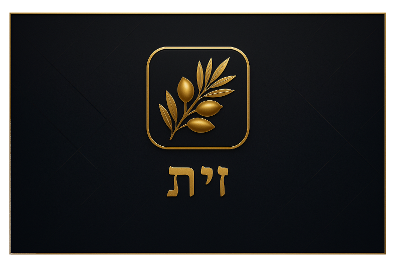
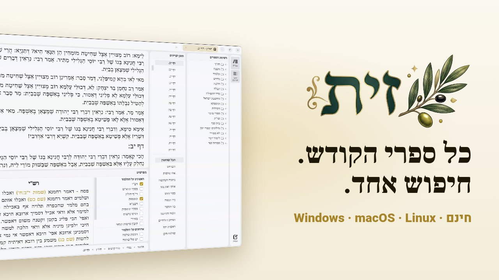
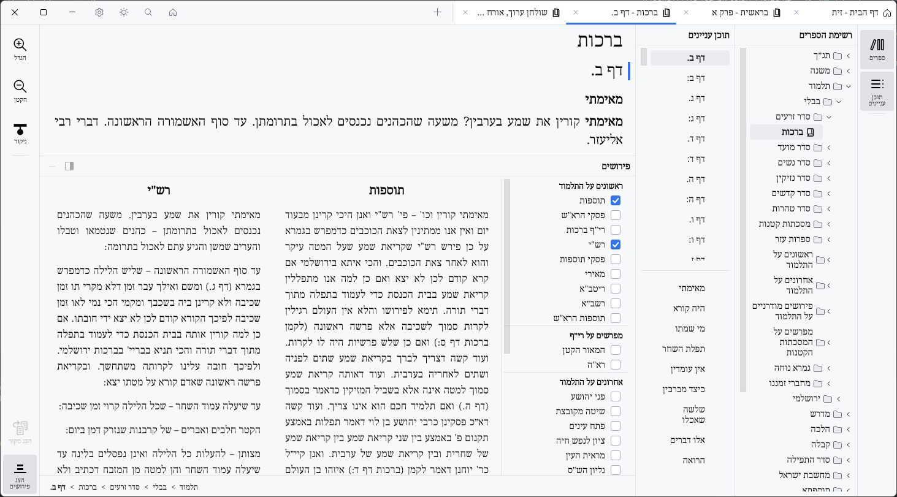
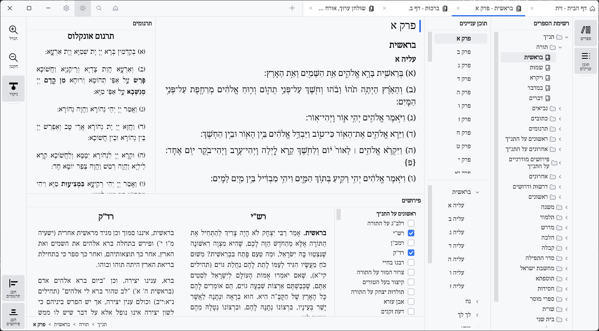
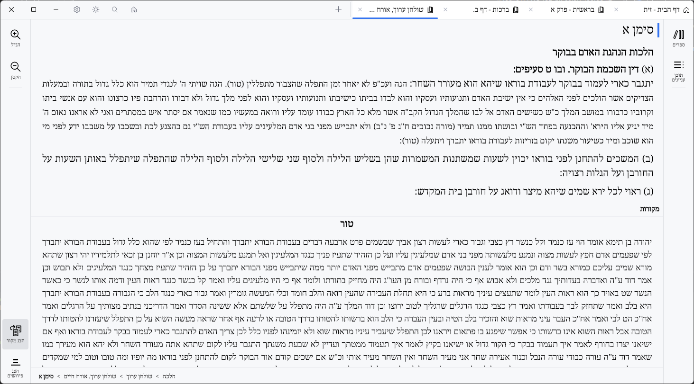

# זית - ספריית הלימוד שמובילה ישר לטקסט

<p align="center">
  <a href="README.MD">English</a> | עברית
</p>

<p align="center">
  
</p>

זית היא אפליקציה חינמית לקריאה, חיפוש וסיור בטקסטי לימוד יהודיים.
בנויה ללימוד: חיפוש מהיר, ניווט חלק, ציטוטים נקיים.
לחזרה, הכנת שיעור, או לימוד בחברותא.

חינם. ברור. יעיל.

<h2 align="center">להורדה לחצו למטה</h2>
<p align="center">
  <a href="https://zayitapp.com/he/download/">
    
  </a>
</p>

<h3 align="center">זית ב-75 שניות</h3>
<p align="center">
  <a href="https://www.youtube.com/watch?v=T7VU3K7EL5w">
    
  </a>
</p>

<p align="center">
  <a href="https://ko-fi.com/lomityaesh">
    
  </a>
</p>

## חזון
זית היא חלום שהפך לשימושי: חוויית לימוד טבעית, זורמת, כמעט מובנת מאליה.
הפרויקט יישאר חינמי מתוך עיקרון. תמיכה מתקבלת בברכה ובמשמעות.
הוא מתוכנן להישאר לא מסחרי.
בעזרת ה', זית תמשיך לצמוח בלי לאבד את רוחה.

## ברוח בית המדרש
זית מעוצבת כמו בית מדרש דיגיטלי: יציב, מהיר, עקבי.
מרגישים את השקט של הלימוד: הכל עובד, הכל במקומו.
הטקסט נשאר במרכז, בכבוד ובלי הסחות דעת.

## ממשק מקצועי וטבעי
זית בנויה על טכנולוגיות JetBrains, כולל Compose Desktop ו-Jewel.
בהשראת Google Chrome ו-IntelliJ IDEA, היא מציעה ממשק מקצועי
שזורם וטבעי, מכבד את הלימוד ולא מעייף את העיניים.
זית קלה לשימוש: אתם כבר יודעים איך, בלי עקומת למידה.
כרטיסיות, חלונות ושולחנות עבודה וירטואליים עובדים כמו ב-Chrome: גוררים כרטיסייה לחלון משלה, מצמידים אותה, פותחים מחדש את האחרונה שנסגרה.

<picture>
  <source media="(prefers-color-scheme: dark)" srcset="art/HOME-DARK.jpg">
  <source media="(prefers-color-scheme: light)" srcset="art/HOME-LIGHT.jpg">
  
</picture>

## דף בית חי
סדרו את דף הבית עם ווידג'טים, כמו בטלפון: גררו אותם, שנו את גודלם, בחרו אותם מגלריה.
זמני היום, לוח עברי, לימוד יומי, מולד וקידוש לבנה, השנים מאז חורבן הבית,
כדור הארץ ומערכת השמש בתלת-ממד, שנים מקרא, מילון, מידות ושיעורים, ההיסטוריה, המועדפים וההערות שלכם.

<picture>
  <source media="(prefers-color-scheme: dark)" srcset="art/WIDGETS-DARK.jpg">
  <source media="(prefers-color-scheme: light)" srcset="art/WIDGETS-LIGHT.jpg">
  
</picture>

## מנוע חיפוש יוצא דופן
סרגל חכם אחד לכל דבר: ספרים, מחברים, מראי מקומות וטקסט. מקלידים ומגיעים ישר למקום הנכון.
מופעל על ידי Lucene ועל ידי מודל ה-embedding של זית, הוא מוצא קטעים לפי מילותיהם ולפי משמעותם.

- הקלידו מראה מקום כמו `חולין יב` או `בראשית א ג` והגיעו אליו.
- ספרים לפי שם או ראשי תיבות, מחברים עם הדף שלהם, הכל מאותו סרגל.
- חיפוש סמנטי: מצאו קטע לפי משמעותו, לא רק לפי מילותיו.
- גם בלי ניקוד, ממילה חלקית או מאיות משוער.
- תוצאות נקיות לפי קטגוריה, כל קטע בהקשרו לצד הרשימה; לחיצה פותחת את הספר בדיוק שם.
- חיפוש בכל הספר, כמו Ctrl+F.

<picture>
  <source media="(prefers-color-scheme: dark)" srcset="art/SEARCH-DARK.png">
  <source media="(prefers-color-scheme: light)" srcset="art/SEARCH-LIGHT.png">
  
</picture>

## מתמצאים בספרייה
עץ הספרייה, תוכן עניינים עם חיפוש משלו, ונתיב ספר לחיץ כמו סרגל הניווט של IntelliJ.

<picture>
  <source media="(prefers-color-scheme: dark)" srcset="art/TOC-DARK.png">
  <source media="(prefers-color-scheme: light)" srcset="art/TOC-LIGHT.png">
  
</picture>

## פאנלים מודולריים
הפריסה מתאימה את עצמה מיד: סדרו את המסך כרצונכם.
הציגו, הסתירו, הפרידו או עגנו את הפאנלים, והתאימו את הקריאה לסגנון הלימוד שלכם.

פירושים: בחרו את המפרשים וקראו אותם זה לצד זה.

<picture>
  <source media="(prefers-color-scheme: dark)" srcset="art/PIRUSHIM-DARK.png">
  <source media="(prefers-color-scheme: light)" srcset="art/PIRUSHIM-LIGHT.png">
  
</picture>

פירושים ותרגומים יחד, סביב הטקסט.

<picture>
  <source media="(prefers-color-scheme: dark)" srcset="art/PIRUSHIM-TARGUMIM-DARK.png">
  <source media="(prefers-color-scheme: light)" srcset="art/PIRUSHIM-TARGUMIM-LIGHT.png">
  
</picture>

תלמוד: רש"י ותוספות לצד הדף, וכל פסוק שמובא בגמרא במרחק לחיצה.

<picture>
  <source media="(prefers-color-scheme: dark)" srcset="art/TALMUD-DARK.png">
  <source media="(prefers-color-scheme: light)" srcset="art/TALMUD-LIGHT.png">
  
</picture>

מקורות: מקור הקטע נפתח לצידו, והספר שלו בלחיצה אחת.

<picture>
  <source media="(prefers-color-scheme: dark)" srcset="art/MEKOR-DARK.png">
  <source media="(prefers-color-scheme: light)" srcset="art/MEKOR-LIGHT.png">
  
</picture>

פרטי הספר: המחבר, התקופה, המהדורה והרישיון של כל ספר.

<picture>
  <source media="(prefers-color-scheme: dark)" srcset="art/BOOK-DETAILS-DARK.png">
  <source media="(prefers-color-scheme: light)" srcset="art/BOOK-DETAILS-LIGHT.png">
  
</picture>

## יותר מספרייה
זית מלווה אתכם לאורך היום: בתפילה, בפרשת השבוע ובתולדות החכמים.

הסידור החכם: תפילות כל יום, בשלמותן, לפי הנוסח והמקום שלכם (בגרסאות הרשמיות).

<picture>
  <source media="(prefers-color-scheme: dark)" srcset="art/SIDDUR-DARK.png">
  <source media="(prefers-color-scheme: light)" srcset="art/SIDDUR-LIGHT.png">
  
</picture>

שנים מקרא: כל פסוק פעמיים ואחריו התרגום.

<picture>
  <source media="(prefers-color-scheme: dark)" srcset="art/SHNAYIM-MIKRA-DARK.png">
  <source media="(prefers-color-scheme: light)" srcset="art/SHNAYIM-MIKRA-LIGHT.png">
  
</picture>

דפי מחברים: דף בסגנון אנציקלופדיה לכל מחבר, עם תקופתו, שמותיו וכל ספריו.

<picture>
  <source media="(prefers-color-scheme: dark)" srcset="art/AUTHOR-DARK.png">
  <source media="(prefers-color-scheme: light)" srcset="art/AUTHOR-LIGHT.png">
  
</picture>

## מה זית מאפשרת לכם לעשות
- מצאו קטע בשניות, לפי מילותיו או לפי משמעותו.
- חקרו את הספרייה לפי ספר ותוכן עניינים בלי לאבד את החוט.
- חפשו בתוך ספר להכנת שיעור או חזרה.
- הציגו פירושים, תרגומים ומקורות זה לצד זה.
- עבדו בכרטיסיות, חלונות ושולחנות עבודה וירטואליים, כמו ב-Chrome.
- שמרו סימניות בתיקיות והיסטוריית ביקורים מלאה.
- סמנו מילים והוסיפו הערות, ישירות על הטקסט.
- העתיקו קטע נקי עם המקור שלו, או שתפו את המקום המדויק.
- גבו את ההערות וההגדרות ל-Google Drive.
- קבלו עדכונים אוטומטיים, כולל הספרייה.
- עבדו מהמקלדת: Ctrl+F, Ctrl+Shift+T, Alt+Home ועוד.
- בחרו מצב בהיר או כהה, את צבע ההדגשה ואת הגופנים שלכם.

## נבנה בקפידה
זית שואפת לאיכות ועקביות: בלי גימיקים, בלי רעש.
כמו שולחן לימוד דיגיטלי, הכל שם כדי להתקדם.
כל פרט מעוצב ללימוד טבעי ומכבד.
בנויה להיות מהירה, קלה, כמעט קסומה, היא רצה גם על מחשבים חלשים, ובלי חיבור לאינטרנט.

## תרומה לפרויקט

זית מקבלת בברכה תרומות מהקהילה: תיקוני באגים ופיצ'רים הרשומים במפת הדרכים.

**שימו לב:** בקשות משיכה (PR) עם פיצ'רים חדשים שאינם במפת הדרכים ככל הנראה יידחו.

### תחילת העבודה

שכפלו את המאגר עם תתי-המודולים:

```bash
git clone --recurse-submodules https://github.com/kdroidFilter/Zayit.git
```

**חשוב:** יש להשתמש ב-JetBrains Runtime 25 (JBR 25) כ-`JAVA_HOME`.

### הנחיות ארכיטקטורה

**מבנה הפרויקט:**
- `SeforimApp/` — אפליקציית שולחן העבודה הראשית (Compose Multiplatform)
- `SeforimLibrary/` — בנייה מורכבת: `core` (מודלים), `dao` (SQLDelight), `generator` (צינור נתונים, JVM בלבד)

**הזרקת תלויות (Metro):**
- גישה לגרף DI דרך `LocalAppGraph.current`
- שימוש ב-`@AssistedInject` + `@AssistedFactory` עבור ViewModels

**מוסכמות שמות:**
- `*ViewModel` עבור ViewModels
- `*View` עבור רכיבי UI
- `*State` עבור מחלקות מצב UI
- `*Event` עבור סוגי פעולות משתמש

**מערכת הלשוניות:**
- כל מסך חייב לדעת את ה-`tabId` שלו
- שימוש ב-`remember(appGraph, tabId)` ליצירת ViewModels
- שימוש ב-`TabStateManager` לשמירת מצב בטווח הלשונית

**ערכות מקור:**
- קוד משותף ב-`commonMain`
- קוד ספציפי לפלטפורמה ב-`jvmMain`
- סוגי פלטפורמה לא יחלחלו מ-`jvmMain` ל-`commonMain`

לתיעוד מפורט, ראו `CLAUDE.md` ו-`TAB_SYSTEM_README.md`.

### מפת דרכים 0.5.0

- תיקון באגים P0 ו-P1

### לפני שליחת PR

הריצו את הלינטר והבדיקות:

```bash
./gradlew ktlintCheck
./gradlew :SeforimApp:jvmTest
```

## תודות
תודה לפרויקטים ולספריות שמאפשרים את זית: JetBrains (Kotlin, Compose Desktop, Jewel),
Apache (Lucene), וכל מחברי הקוד הפתוח.
תודה גם לספריא ולאוצריא על האיכות והפתיחות של בסיסי הנתונים שלהם.

## מקורות וזכויות
זית נשענת על קורפוסים מ-**[ספריא](https://www.sefaria.org.il/)** ומ-
**[ספריית אוצריא](https://github.com/Otzaria/otzaria-library)**, שהומרו ל-SQL דרך
**[SeforimLibrary](https://github.com/kdroidFilter/SeforimLibrary)**.
לכל יצירה עשויים להיות תנאים משלה: המשתמש מתחייב לכבד אותם.
זית ומחבריה אינם יכולים להיות אחראים לשימוש שאינו תואם.

## טיפוגרפיה
הפרויקט כולל גופנים ברישיון: **רש"י אמיתי** (בלעדי לזית,
באישור מ-**[The ImageMaster](https://www.theimagemaster.com/)**) וגופנים מפרויקט
**[Culmus](https://culmus.sourceforge.io/)** (הרישיונות שלהם).

## רישיון ושיתוף
זית היא חינמית וקוד פתוח, מפורסמת תחת **[AGPL v3](https://raw.githubusercontent.com/kdroidFilter/SeforimApp/refs/heads/master/LICENSE)**.
שיתוף מעודד - זו מצווה.

---

## ליבה פתוחה (Open core)
זית בנויה כ"ליבה פתוחה": כל מה שבמאגר הזה חינמי וקוד פתוח תחת AGPL v3, ונבנה לאפליקציה שלמה. הגרסאות הרשמיות כוללות
גם מודולים קנייניים שאינם קוד פתוח, כמו **הסידור החכם**; גרסה שנבנית בלעדיהם פועלת בדיוק אותו דבר, רק בלי אותם
מודולים. תרומות נכנסות לליבה הפתוחה, ו[הסכם התורמים (CLA)](CLA.md) מאפשר לכלול אותן גם בגרסאות הרשמיות.

זית היא חינמית וקוד פתוח בליבתה. לפרטי הרישיון, ראו `LICENSE`.

<p align="center">נבנה באהבה על ידי אליהו גמבש ❤️</p>
